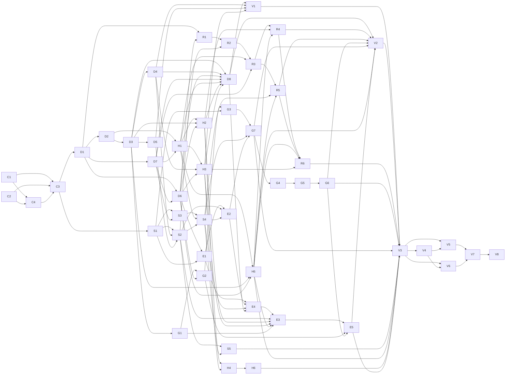

# Declaration and derive macros: delivery plan

This execution plan belongs to
[TASK-0068](../../tasks/TASK-0068-top-level-declaration-macros.md) and tracks
the authorized remaining delivery of accepted
[CP-0034](../../proposals/CP-0034-top-level-declaration-macros.md). It does not
define Ash semantics or expand the task's authority. The reviewed
[work structure](slice2-work-structure.md), original unit dependencies,
difficulty predictions and fixed [I01–I22 corpus](fixtures/README.md) remain
unchanged. The refresh below records the inspected state on 2026-11-09 and
the remaining connections; recheck live refs before dispatch or integration.

## Baseline and outcome

Produce imported, hygienic top-level declaration macros and type/newtype
derives, including declarative templates, checked Ash transformers, repetition
and state-threaded generators. Generated declarations go through ordinary Ash
parsing, resolution and checking. Include the actual public compiler path,
diagnostics, supported runtime/build consumers and final delivery evidence.

Slice 1 was retained at `e58aea09` and integrated through merge `5852a977`.
The current [syntax expansion specification](../../../spec/syntax-expansion.md)
is the expression-macro baseline. The original slice 1 task and QA record can
be read from Git at
`d0b1bf68:docs/tasks/TASK-0067-expression-macros.md`.

The verified retaining branch is `codex/task-0068-integration` at
`476b5ca9e4b4c7fdfacf7baa27e43094d8551d9b`, tree
`7087eb1cbdd4e8a9ffd331011b3560c136cd9395`; the inspected live remote ref
matches. CP-0034 has partial implementation on that branch. D1 and S1 are
closed; the other 43 child issues remain open across seven workstreams. All
112 native blocking links match the reviewed dependency graph. No repository
PR was open at inspection. Retained focused evidence does not establish D8,
E4, V3, a fresh full-workspace checkpoint or final acceptance.

The user authorized delivery branches, implementation of the accepted scope,
required verification, issues and PR updates, independent reviews and GitHub
squash merges into the retaining branch. Do not GPG-sign locally authored
commits; GitHub's automatically signed squash commits are acceptable. Main
integration requires a separate instruction.

### Retained deliveries

Each squash tree below equals its reviewed candidate tree. The issue records
and linked PR reviews retain the focused receipts and remaining obligations;
the table is a retention inventory, not acceptance of incomplete criteria.

| PR | Retained squash commit | Status |
| --- | --- | --- |
| [#259](https://github.com/dikini/ash-lang/pull/259) | `16b5acf7fbc80b2dfd7d9c55976f88ac4e64888e` | D1 header/reservation scope; completed after #266's uppercase-capture repair. |
| [#260](https://github.com/dikini/ash-lang/pull/260) | `f1d02fcdf95cde4a096b3717d6aa7294a480eebc` | S1 closed sums and token kinds complete; later connected migration remains with S5/E2/E4/V3. |
| [#261](https://github.com/dikini/ash-lang/pull/261) | `0b70a56ffdb575238a5877a6745d600fbd68fc8f` | Partial D2 selection; original public-driver criteria remain open. |
| [#262](https://github.com/dikini/ash-lang/pull/262) | `0fd179a972715e34396aa9ae0aac745ddf898af4` | Partial D7 structured parser; connected output assertions remain open. |
| [#264](https://github.com/dikini/ash-lang/pull/264) | `5ab3ebef1fd1d451e768839070202614f64a0344` | Partial D6 template admission; procedural-output and diagnostic obligations remain open. |
| [#266](https://github.com/dikini/ash-lang/pull/266) | `5e2a68bc814016581a2ced5ddc2713d603f924c3` | Partial D3 matcher and completed D1 capture-name repair; full I19 and diagnostics remain open. |
| [#267](https://github.com/dikini/ash-lang/pull/267) | `8106ec33e59ea32ca1538678a85c67e9068c3456` | Partial D4 type/pattern captures; public protected-fragment consumption remains guarded. |
| [#268](https://github.com/dikini/ash-lang/pull/268) | `a741c85b53d8aa8156f5502fa5c35e508a29ff52` | Partial D6/D7 foreign admission metadata repair. |
| [#269](https://github.com/dikini/ash-lang/pull/269) | `eea3dbc86b731f85993b6f02370172751b78cdd3` | Partial D4/D6 protected template admission and substitution. |
| [#270](https://github.com/dikini/ash-lang/pull/270) | `091639de8e493e8fc05da9bef46d21227f5176e8` | Partial D6/D7 nested-template admission without execution. |
| [#271](https://github.com/dikini/ash-lang/pull/271) | `199bf28484380742a775ef0b709b12b5c0f1fe86` | Partial H1 identifier-only collection; protected/procedural paths and original criteria remain open. |
| [#273](https://github.com/dikini/ash-lang/pull/273) | `d19f36f5cdeb34940fe0b130209006020e6729d9` | Partial H2 identifier-only term-context tests; origins, recursion and full criteria remain open. |
| [#275](https://github.com/dikini/ash-lang/pull/275) | `476b5ca9e4b4c7fdfacf7baa27e43094d8551d9b` | Partial H3 identifier-only nominal-context tests; pattern/interface and diagnostic criteria remain open. |

The preserved product worktree
`/home/dikini/Projects/ash-lang-task-0068` is on
`codex/task-0068-protected` at the retaining base. Its untracked
`tests/declaration_type_capture.rs` was inspected and preserved before this
refresh. SHA-256:
`a252ebaffc5125934d51c88511d998c4cc8308c6650a26a20570bc2b0c663841`.
It contains I07 and imported type-forwarding tests, not a retained delivery.
The documentation candidate uses `/tmp/ash-task0068-delivery` on
`codex/task-0068-plan-refresh`; neither this checkout nor a later branch switch
may discard the protected work or main's unrelated effects work.

### Roles and shared ownership

| Role | Setting and responsibility |
| --- | --- |
| Orchestrator | Inherit the launching agent's model and effort. The active `/root` orchestrator owns eligibility, assignments, closure and **integration**. |
| Planning | GPT 6.1 Sol Max; refresh the remaining chain and interfaces. |
| Development | GPT 6.1 Terra Max; assigned product writer, focused evidence, repairs and acceptance updates. |
| Independent QA | Terra 6.1 Medium; check each pinned delivery and the integrated corpus. |
| Independent review | Sol 6.1 Max; challenge this plan, post every PR review, re-review repairs and independently check the acceptance record. The developer applies the checked record and performs readback; the orchestrator confirms. |

Keep development, QA and review independent, including replacements. A developer
cannot approve their own change. The orchestrator names each active worker in
its assignment and assigns one heavy-build operator. One owner controls shared
grammar, projection, surface, syntax and driver files. Use isolated delivery
branches; parallel edits require agreed interfaces and disjoint file ownership.
Keep one sequential product checkout and compatible target cache, with one
Cargo job. Reviewers inspect immutable pins and request reruns from the operator.
Freeze and release readers and preserve owned uncommitted work before switching
branches. QA/review on one unit may overlap development on a different unit.

## Hard boundaries

- **Implementation is limited to parsing and syntax transformation.** Carry
  syntax contexts, source spans and expansion origins into the existing
  compiler pipeline. Macros produce code without proving or repairing its
  validity. The ordinary parser and downstream compiler diagnose errors in the
  produced code. Helpers that support parsing or rewriting are in scope; helpers
  that establish the semantic correctness of generated Ash are not.
- Do not add or change type checking, inference, semantic verification,
  elaboration, Core validation or other downstream compiler logic. In
  particular, do not modify resolution or publication rules to make an
  expansion succeed. The ordinary downstream compiler checks generated code
  and reports its errors. Tests may exercise that existing behavior.
- If a downstream subsystem misses a required check or cannot consume the
  transformed syntax, retain its contexts/spans, or report a useful error,
  record a separate issue for that subsystem with a reproducer and expected
  behavior. Stop the dependent path and continue independent work. Do not
  implement a substitute check or patch the downstream subsystem in this slice.
  Return a language-contract change to CP-0034 for a design decision. The local
  plan records findings; it does not create GitHub issues without authorization.
- Do not change expression-macro behavior from slice 1, including its syntax
  imports, context selection, protected fragments, diagnostics or host limits,
  except for CP-0034's accepted `syntax` reservation and syntax-service sum
  extensions.
- Do not implement local declaration macros, generated imports or syntax
  definitions, derive attributes, arbitrary parser callbacks, inferred-type
  reflection or Core generation by macros.
- The parser checks syntax; macro machinery matches, rewrites and threads
  generator state; ordinary compiler stages resolve and check the result. Do
  not introduce a macro-specific type checker, per-declaration semantic checker
  or a second visibility/duplicate-checking system.
- Do not reintroduce per-reference grant objects or broad Core correspondence
  checks. Preserve issued contexts and use the retained resolver, access rules
  and linking closure. Keep authenticated syntax handles and host boundaries.
- Do not add compiler `Input` to generator step functions or an ambient input
  service to connect their state. An expression-fragment step has the ordinary
  `State -> (State, Syntax.ExpressionFragment)` type. Helpers may have any
  ordinary Ash type; ordinary checking and the retained host rules apply.
- Do not redesign effects or resources, add Wasm support, generalize the
  compiler for hypothetical future macros, or refactor unrelated code.
- A necessary change outside a unit's scope returns to the design owner with a
  concrete example. Stop the affected part; continue independent authorized
  work. Do not silently expand the assignment or invent semantics locally.

## Retained boundaries and interfaces

The intended vertical path is:

```text
entry module -> discover fixed imports -> select imported syntax -> parse
declaration invocation -> match captures -> expand template or checked Ash
transformer -> parse structured declaration output -> expand derives in source
order -> collect module declarations -> ordinary resolve/check -> link/validate
-> interpreter and supported build/image consumer
```

The procedural branch enters the retained checked host, transfers output before
closing its root, and preserves failure and origin information. Declaration
and derive expansion may have different entry forms while following the same
source order. There is one integration owner for this entire path. Component
tests do not replace its acceptance check.

These interface agreements constrain remaining assignments. The developer owns
each producer/consumer implementation; the orchestrator assigns shared files,
QA checks the evidence and Sol reviews the handoff. They do not mandate new
Rust types or public APIs. A changed interface returns for independent review
before substantial dependent implementation.

| Boundary | Producer -> consumer | Required agreement |
| --- | --- | --- |
| Selection | Import discovery -> parser and expander | Preserve local syntax name, category, selected owner and rename, including introduction-to-import mapping. Keep expression compatibility and collision causes; retain H1's equal-matcher/different-owner and later expression-introduction checks. |
| Captures | Matcher -> template or transformer | Preserve category, repetition nesting, order, owned AST, shared contents, contexts and origins. Charge real copies, traversal, frame work and composed depth before allocation through the existing shared accounting. Incomplete/recovery-bearing input does not cross projection. Unsupported paths stay guarded until their real consumers pass. |
| Output | Template/host -> declaration parser and collector | Transfer ordered structured syntax and protected fragments with authentic origins. Reuse ordinary category parsing without text re-lexing. Refuse forbidden/recovery-bearing output and publish no partial module on failure. |
| Module staging | Collector/derive entry -> ordinary resolver | Preserve source-order expansion, the original derive subject once, generated declarations, forward references, scope and export spelling. Ordinary resolution/publication owns access, conflicts and nominal identity; exercise real callers and importers. |
| Generator | Matcher/seed/step -> template repetition | Definition-site seeds and steps use the already checked defining-module environment. Caller-supplied seeds use the caller's available compile-time environment: inline expressions and checked imports, excluding the caller module's own globals. Preserve these contexts and ordinary checking/staging failures. Use ordinary `State -> (State, Syntax.ExpressionFragment)` calls, one state advance and cached value per iteration, and nested ownership. Prove both selected construction paths and state/handle lifetime in the retained checked host before dependent generator work. |
| Quote and escape | Template/ordinary Ash -> checked host -> syntax admission | Pass lexical capture values and quote holes with contexts/origins. Execute one reached escape per expansion position under existing limits and atomic failure. Reads participate in repetition driver rules; ordinary checking/admission owns type/category failure. |
| Provenance and host | Syntax services -> parser, resolver, diagnostics and linker | Preserve contexts separately from origins, authenticated handle provenance and lifetime, checked-host effects and work/depth/stack bounds. Transfer final output before root teardown. Check valid output after closure, foreign-handle refusal and both exact I16 controls at V3. Stop an affected path at a concrete downstream consumer gap. |

Likely implementation areas on the retained baseline are `src/parser/grammar.rs`,
`src/parser/project.rs`, `src/surface.rs`, `src/syntax.rs`, `src/driver.rs`,
`src/compiler_syntax.ash`, `src/eval/syntax.rs` and their existing tests. Any
driver or host change is limited to syntax input, transformation and handoff;
it does not authorize changes to downstream compiler logic. Exact file
ownership follows the agreed interfaces and actual diff; these are not
permission to refactor an entire file. Use `tests/surface_macros.rs`, `tests/macro_host.rs`,
`tests/modules_syntax.rs`, `tests/module_loading.rs`, `tests/diagnostic_json.rs`
and the relevant existing image/build tests where they own the boundary.

## Remaining delivery sequence

The sequence refines implementation order without adding unit dependencies,
changing original acceptance criteria or allocating new difficulty points.
Retained, independently reviewed producer handoffs may unblock focused
consumers while the producer's full connected criterion remains open. This
does not remove native blocking links or authorize premature issue closure.

| Step | Delivery and prerequisites | Required result and next owner |
| --- | --- | --- |
| 1 | Resume #232's type-only protected-fragment resource work at the verified retaining tip. | Developer first establishes and verifies v3's proposed narrow type-to-expression refusal while retaining the existing broader protected-capture guards. Then precharge capture construction, substitution, staged adaptation and generated projection through the existing `SyntaxBudget` before relaxing the type guard for the intended declaration path. Unchanged I07 returns 42; the missing type keeps its parser cause. Real imported doubling/grouping chains, exact/short allowances, composed type/application/row depth, late failure and small-stack cleanup pass before type activation. Expression/pattern/procedural matchers and the newly established narrow refusal remain guarded. QA and Sol check the pin. |
| 2 | Complete protected expression/pattern accounting and consumption. | Developer extends the same shared accounting to every owned expression/pattern/local-declaration/recursive-capture copy and traversal, retained contents and composed depth. Unchanged I19 `binder.ash` reaches the ordinary driver for 42 with contexts and origins; refusal and failure cleanup remain bounded. QA and Sol check the actual consumer. |
| 3 | Review connected D2/D3/D4/D6/D7/H1/H2/H3 assertions on the available paths. | Close only an original criterion whose complete required evidence is retained. Defer D3's full I19 criterion to D5 and G1; defer D6's procedural-output import refusal to S3 and S4. Prior partial H1/H2/H3 tests do not close their original criteria. Keep diagnostic and protected-path obligations open; Sol checks the developer's partial record, the developer applies it and reads it back, and the orchestrator confirms and schedules D8 when its complete inputs are ready. |
| 4 | D5, G1 and H5 consume the retained D3/D6/H1 handoffs as applicable. | Developer supplies one complete braced declaration, ordered nested repetition captures and definition-private/facade context evidence. H5 exercises unchanged resolution and private-access refusal. These paths may prepare in parallel only with disjoint assigned files; shared grammar/projection edits are serialized. |
| 5 | S2 consumes S1/D4/D5; S3 consumes S1/D7; S4 consumes S2/S3/H1; S5 consumes S2/S4. | Developer establishes authenticated category/handle transfer, root lifetime and teardown together. S4 runs the supplemental procedural declaration graph for 42 and its authored refusal with no publication. S5 completes connected I18 migration. Valid output survives root closure; foreign handles reject. |
| 6 | E1 consumes D6/S1; E2 consumes E1/S2/S4; E4 consumes E1/E2/S4/D8. | Developer connects ordinary checked quote construction and early escapes. Supplemental I22 `early_nested.ash` returns 44; category/code/primitive refusals and bounded atomic failure pass. Integration owner pins the E4 full checkpoint; the assigned operator runs it. |
| 7 | R1 -> R2 -> R3 -> R4/R5 -> R6, retaining the original S2/H1/D7/H2/H5/S4/H3 joins. | Developer establishes original-subject capture, one retained subject, complete source-order derive lists, declarative/procedural output and generated-subject expansion. Preserve all I09–I11 and I20 ordering/failure assertions. QA and Sol review each connected increment. |
| 8 | G1 -> G2 -> G3 -> G7 -> G4 -> G5 -> G6; G7 additionally consumes S4/E2. | Developer proves both fixed fragment construction paths with state-only steps before initialization/caching/nesting. Preserve I17's 310/3210/1010/546210 results and ordinary-checking, category and bound failures. A helper alone does not establish a whole caller. |
| 9 | H4 consumes H2/H3; H6 consumes H4. E3 consumes E4/S2/H2/H3/H5/G1; E5 consumes E3/G2/G6. | Developer connects public spelling/context and importer visibility to unchanged publication, then lexical escape captures and repetition/cached generator reads, including zero iterations. Complete the separately reviewed protected type-to-expression gate before activating that combination. |
| 10 | V1 consumes D8/D4/D5/H3; V2 consumes D8/R4/R5/G6/G7/H5/E5; V3 retains all original joins. | Developer and integration owner join the fixed real macro library, caller and importer through public driver, interpreter and supported build/image consumers. Original full graphs remain mandatory alongside early supplements. Both exact I16 mutations, host limits, transfer and teardown are required. |
| 11 | V4 -> V5/V6 -> V7 -> V8 after V3, preserving every original edge. | Developer updates specification/tool documentation for the implemented delta. Independent QA and Sol audit the exact integrated pin; developer repairs findings and Sol re-reviews. Integration owner obtains the fresh full gate and native/image receipts, squash-merges into the retaining branch and verifies the retained result. Sol independently checks the acceptance record; the developer applies it and performs readback; the orchestrator confirms. Main remains a separate gate. |

For each partial result, the developer records **Delivered**, **Remaining**,
**Awaiting** and **Owner**, with its PR, retained commit and evidence. Keep the
original checkbox unchecked until its whole criterion passes, including any
deferred consumer or checkpoint obligation. Sol independently checks the
acceptance record, the developer applies the checked record and performs
readback, and the orchestrator confirms before advancing. The latest H1/H2/H3
issue records still request this acceptance check/application/readback; equal
trees and a clear PR review do not establish that it occurred.

### Protected type-to-expression accounting and release gate

This is a named acceptance obligation within the existing H1/D8 protected
fragment work, not a new language feature, work unit or budget protocol. When
the broader declaration-staging guards are relaxed, a forwarded type can reach
a generated expression macro invocation argument. That argument becomes a `SurfaceExpressionCapture`
and later reaches slice 1's `SyntaxExpansion::expand` and
`substitute_contents`, outside the currently charged declaration-staging work.
The retained base's broader protected-capture guards prevent a public
reproducer. The narrower refusal proposed in v3 is not implemented on that
base; this is a source-audit finding, not evidence of a demonstrated slice 1
failure.

The type-only delivery must first establish and verify v3's proposed temporary
refusal of a forwarded type anywhere inside such a generated expression
invocation argument, with the existing broader guards retained. Only then,
after the type-only accounting evidence passes, may it relax the broader type
guard for the intended declaration path. Keep the established narrow refusal
until this release gate passes. The narrow refusal excludes ordinary
non-protected expression syntax and declaration-invocation type forwarding.
Before releasing the guard, have Sol separately review the complete copy and
consumer inventory. Every subsequent owned copy, traversal, retained frame or
contents operation and composed-depth check must use the same existing
`SyntaxBudget` and shared accounting. Do not fix the path by changing language
rules, slice 1 behavior, limits or an error protocol.

The developer supplies a real imported declaration-template -> expression
invocation -> ordinary consumer graph, not a direct-projector substitute.
Required evidence covers repeated protected copies, exact-allowance success
and one-less refusal, composed depth, late failure after earlier output,
small-stack success and failure, normal/failure drop and cleanup, authentic
contexts/origins, no partial publication and unchanged slice 1 regressions.
QA checks the pin independently and Sol reviews/re-reviews before activation.
If complete shared accounting cannot be achieved within these boundaries,
keep the guard, stop that affected path and return the concrete finding for a
decision. Do not claim full connected acceptance while it remains guarded.

The existing type-first plan and v3 refinement are working evidence under
`/home/dikini/Projects/ash-lang-task-0068-evidence/protected-plan-476b5ca9/`.
Their type-copy, retained-contents/drop and forwarding analysis transfers only
within the inspected scope. Expression/pattern activation still needs its
exhaustive inventory; the type-only analysis does not prove those families.

### Connected checkpoints and final gate

| Gate | Completion condition and owner |
| --- | --- |
| D8 first declaration path | I01/I07 execute for 42 through the public driver; generated ordinary errors retain cause and macro origins; integrated H2/H3 and protected-copy/composed-depth evidence is complete. Integration owner pins the candidate and assigns the fresh full-workspace checkpoint. Type-only I07 success is partial progress. |
| E4 early quote/escape path | Supplemental `early_nested.ash` executes for 44 through the public driver with its negative, atomicity and bound cases. Integration owner pins the second fresh full-workspace checkpoint. Original shared-module I22 graphs remain required at V3. |
| V3 complete public path | All original producer/consumer joins, I01–I22 full graphs, both exact I16 controls, interpreter and supported build/image evidence are present. Integration owner freezes the candidate for documentation and integrated QA/review. V3 is a connected acceptance gate; the final fresh full-workspace gate remains V7. |
| V7/V8 retaining acceptance | After independent V5/V6 and repairs/re-review, the assigned operator runs fresh `cargo xtask verify` and required native/image checks with exact input receipts. Integration owner verifies the actual retained squash result. Sol independently checks the acceptance record; the developer applies the checked record and performs readback; the orchestrator confirms. |

Follow the [verification guide](../../project/verification.md): one Cargo job,
compatible cache, source/configuration/tool/external-input pins and unchanged
inputs before/after each required gate. A focused or reused receipt never
becomes a fresh full gate by description. At every delivery handoff, name the
last full-gate pin/receipt, intervening deliveries, remaining regression scope
and next checkpoint owner/trigger. No TASK-0068 full-gate receipt is established
at this refresh.

### Downstream blockers and forecast

The following separate downstream issues were all open and unassigned at
inspection. Active repair owners and timing are unverified; dependent criteria
remain blocked and repairs stay outside this task:

- [#263](https://github.com/dikini/ash-lang/issues/263): unbound-splice syntax
  cause/location is erased before presentation.
- [#265](https://github.com/dikini/ash-lang/issues/265): human/JSON parser
  diagnostics omit authentic invocation/selected-definition roles.
- [#272](https://github.com/dikini/ash-lang/issues/272): ordinary duplicate-global
  diagnostics lose generated locations already present on names.
- [#274](https://github.com/dikini/ash-lang/issues/274): ordinary duplicate-type
  and constructor diagnostics lose those generated locations.

The integration owner verifies their live owner/status before reporting further
progress and tracks these downstream dependencies; their repair is outside this
macro assignment. Required H2/H3/D8/V2 and final
diagnostic acceptance remains open until the real consumers supply its evidence.
Re-pin their concrete reproducers to the relevant retained inputs; do not add
macro-side checks, fake origins, expected-missing-origin assertions or a
downstream patch to make acceptance appear complete. Continue eligible
independent work and return any needed scope decision explicitly.

Preserve the **150-point** total and **142-point** initial remaining prediction
below. D1/S1 account for seven fully closed predicted points; the 43 open units
sum to 135 original points and include retained partial work. This is an
inventory of original estimates, not a measured effort remainder or earned
credit. No point prediction or DAG edge changes in this refresh. Historical
bounded retention intervals range from about 18–44 minutes to roughly four
hours for H1 and do not establish a rate for the remaining host, escape and
generator work. A whole-delivery elapsed forecast must include that entire
chain, builds, QA/review, repairs, three full checkpoints, acceptance and the
unresolved downstream wait; time to the next type repair is not time to final
acceptance. A bounded completion ETA is unavailable while downstream ownership
and repair timing remain unresolved.

## Pre-implementation contract checks

These checks are recorded planning work. They do not add implementation or
silently decide language semantics.

| Unit | Result | Points | Prerequisites | Gate |
| --- | --- | ---: | --- | --- |
| C1 | Reconcile CP-0034 with slice 1's grammar, service, contexts and host. | 2 | Slice 1 on local main | **Planning reconciliation recorded:** see the proposal and [boundary record](declaration-slice.md#slice-1-contract-boundary). I18/I21 connected tests await slice 2; check their inputs against the retained interface during delivery. |
| C2 | Record the ordinary typed generator contract. | 2 | Retained syntax service | **Decision recorded:** any ordinary function of the required state-to-pair type can be used; normal Ash checking applies. Both subtemplate and procedural construction are selected. C4 owns complete proposed I17 source inputs; G7 owns their implementation and connected evidence. |
| C4 | Transcribe complete I17 source variants from the fixed behavior. | 2 | C1, C2 | **Source inputs prepared:** both selected 0–5 fragment builders, ordinary state-only steps/helpers, callers and negative variants are mapped in the fixture record. They are proposed inputs, not passing macro tests. |
| C3 | Independently review and freeze interfaces, corpus inputs and scope. | 2 | C1, C2, C4 | **Independent review completed:** no remaining findings in the reviewed candidate. The review covered I17 and I22, the boundary map, connected path, exclusions and the initial corpus, including syntax and origins reaching downstream consumers. I12's connected checks remain with H2–H4 and V3. Slice 1 has no selectable interface version; artifact versioning remains separate. |

C4 prepared the subtemplate and quote-backed procedural I17 source graphs,
callers, controls and negative cases. C3 independently reviewed the proposal,
retained slice 1 boundary and proposed corpus, including the added I22 escape
cases; the author and independent Sol 6.1 Max reviewer found no remaining
findings. The
[fixture record](fixtures/generators/README.md#construction-details-needed-for-transcription)
records the procedural graph's raw-syntax construction coverage limit. These
are fixed acceptance inputs; G7's implementation and connected evidence remain
open. CP-0034 is accepted and partially implemented on the retaining branch.
The 130-point forecast predates the approved executable-escape design and token changes; the
recalibration below accounts for both.

Implementation units below require **accepted CP-0034, C3, an owning task and
an authorized implementation base**. C1–C4 are recorded planning work; this
refresh changes neither their contract nor the accepted proposal.

## Planned work units

Points are fixed predictions of relative difficulty, including each unit's
focused verification and review. They are not elapsed time or earned credit.
Each unit was assigned at most four points; the sum is retained below.
The total-scope prediction is 150 points, with 142 predicted delivery points
at the original launch. The inspected partial state is recorded above.
Preserve the earlier 65-, 95-, 126-, 128- and 130-point predictions as
historical records. These are not measured results or arithmetic conversions
from slice 1.

The I-identifiers refer to the [initial corpus](fixtures/README.md). A focused
gate may establish an early parser or component assertion, but its connected
driver assertion remains pending until its consumers exist. Negative inputs
and expected results are those specified by the linked fixture README.

### Declaration syntax and the first path

| Unit | Result | Points | Prerequisites | Acceptance gate |
| --- | --- | ---: | --- | --- |
| D1 | Parse and project `syntax declaration: (name)` headers and the reserved `syntax` word. | 3 | C3 | I21 expression headers still parse except names now prohibited by the reservation; malformed new headers and I22 user-defined `syntax` terms, macro names, module paths and imported aliases reject. `syntax_value`, `declaration` and `@builtin.compiler.syntax` remain usable. |
| D2 | Select imported declaration syntax by category and rename. | 3 | D1 | I21 renamed import works; collision and same-module use reject. |
| D3 | Match declaration invocations with identifier and expression captures. | 3 | D2 | I01/I07/I19 select the intended captures; missing input fails at the invocation. |
| D4 | Connect type and pattern captures to their ordinary parsers. | 3 | D3 | I07/I19 type and binder/body captures retain boundaries; invalid category rejects. |
| D5 | Match one complete braced declaration fragment. | 3 | D3 | I19 multiline signature/equation capture is retained; incomplete or multiple declarations reject. |
| D7 | Parse structured output for the first declaration path. | 4 | D1 | Parse I01/I07 handwritten target forms; reject incomplete and recovery-bearing declaration input without text re-lexing. Macro-output assertions need D6 and D4 where applicable. |
| D6 | Parse declaration templates and validate macro notation using D7. | 3 | D1, D7 | I14 `unused_bad.ash` and literal `forbidden_import.ash` reject at definition admission; I15 unused unresolved free name is admitted. Imports produced by procedural output are rejected at output admission after that path is connected. |
| D8 | Connect a declaration template through the public driver and ordinary checker. | 3 | D3, D4, D6, D7, H1, H2, H3 | I01/I07 execute to 42; an ordinary generated type error retains its normal cause and macro origins. |

**Boundary:** extend the existing grammar/projection and structured expansion
path. Do not add a parser implementation per declaration form or perform
downstream semantic checking in the expander.

### Module contexts and publication

| Unit | Result | Points | Prerequisites | Acceptance gate |
| --- | --- | ---: | --- | --- |
| H1 | Hand generated declarations to the existing module-collection path. | 3 | D2, D7 | Focused syntax handoff preserves forward references; I20's public-driver recursion assertion also needs H2. |
| H2 | Preserve caller-selected and introduced term contexts in syntax. | 3 | H1, D3, D6 | Focused I12 `early_terms.ash` preserves distinct caller-selected helpers and gives 84; `early_terms_duplicate.ash` and `early_terms_handwritten_duplicate.ash` reject in ordinary resolution with both sources and macro origins. A focused handoff to the actual resolver may be used before D8; the public-driver assertion and full I12 graph remain connected gates. |
| H3 | Preserve type, constructor, interface and pattern contexts in syntax. | 3 | H1, D4, D6 | Focused I12 `private_types.ash` and I19 `binder.ash` handoffs preserve nominal and pattern contexts; duplicate private types and constructors fail in ordinary resolution with both sources and macro origins. Their public-driver results remain connected gates after D8. |
| H4 | Emit macro-written public names with the agreed spelling and contexts. | 4 | H2, H3 | I12 invoking and importing modules use the generated public function, type and constructor; existing duplicate checks reject collisions. |
| H5 | Preserve definition-context references and their syntax provenance. | 3 | H1, D3, D6 | Focused I13 `early_owner.ash` passes definition-private helper and renamed facade references to the unchanged resolver despite caller shadowing; `early_owner_private.ash` rejects direct private access. Its public-driver result and the full I13/opacity graphs remain connected gates after D8 and at V3. |
| H6 | Hand generated declarations and implementations to ordinary publication. | 2 | H4 | I03/I04/I12 importer visibility and duplicate implementation checks use unchanged downstream rules. |

**Boundary:** transform syntax and preserve contexts, then hand the result to
unchanged resolution, visibility, evidence and publication. Do not modify those
stages or introduce per-reference grants or macro duplicate/type analysis.

### Syntax service and procedural host

| Unit | Result | Points | Prerequisites | Acceptance gate |
| --- | --- | ---: | --- | --- |
| S1 | Extend the agreed closed syntax sums and capture shapes, including `SyntaxKeyword` and `Dollar`; preserve existing fragment cases and origin metadata. | 4 | C3 | I18 old exhaustive capture match fails for missing cases; explicit migration and fallback are checked. I22 `token_exhaustive.ash` fails ordinary coverage under CP-0034; `token_kinds` recognizes the new tokens and rejects incorrect spellings. Its connected quote round trip also needs E2 and E4. |
| S2 | Expose protected type, pattern and declaration fragments to checked Ash. | 3 | S1, D4, D5 | I11/I19 preserve category, contexts and origins through parse and unwrap, including nested groups and siblings; wrong category and excess depth are refused without a stack abort. |
| S3 | Transfer structured declaration output through the retained host. | 4 | S1, D7 | Focused host transfer rejects a foreign handle and retains valid structured output after root closure. Nested groups and siblings exercise parse-service and final-output transfer; excess depth fails without partial publication. The exact I16 indexed-transformer mutation remains at V3; I14 wrong-category graph also needs S2. |
| S4 | Connect checked procedural declaration expansion to module staging. | 3 | S3, H1, S2 | Supplemental I16 `procedural_declaration/main.ash` uses a real checked declaration transformer through the public driver and returns 42; `rejected.ash` retains its authored rejection and publishes nothing. The exact I16 derive/teardown graphs remain at V3. |
| S5 | Complete closed-sum migration through the production path. | 3 | S2, S4 | I18 original expression transformation returns 42 after migration; new cases and valid fallback behave as specified. |

**Boundary:** reuse the checked Ash host, syntax services, bounds and teardown.
Do not create a second host or assume a selectable syntax-interface version
without a reconciled contract. Preserve the retained stack-safe transfer path.

### Quotation and executable escapes

| Unit | Result | Points | Prerequisites | Acceptance gate |
| --- | --- | ---: | --- | --- |
| E1 | Parse and admit expression quotes, escaped blocks and their nesting with the containing definition. | 4 | D6, S1 | I17 `malformed_helper.ash` rejects its unused malformed quote at definition; I22 `unbound_outer.ash` rejects an unknown outer splice. The I17 malformed generator graph remains a G7 gate after its repetition and generator forms exist. Existing `$name` and repetition forms keep their meaning; parsing does not execute an escape. |
| E2 | Construct expression fragments from quotes in ordinary checked Ash, with variable holes and protected syntax. | 4 | E1, S2, S4 | Focused checked-host execution of the I17 ordinary `digit`, `as_subtemplate`, `next_number` and `is_first` helper slice supplies the fixed 0–5 fragments; `wrong_hole.ash` fails ordinary checking. The full I17 module and caller gates remain with G7/G5/G6/V3. Once E4 connects escapes, I22 `freshness.ash` returns 20 and constructions from the same quote source have distinct introductions; the quote round trip checks structure, contexts and origins. |
| E4 | Prepare ordinary escaped code for checking, execute reached escapes through the existing checked host and insert their results through syntax admission. | 4 | E1, E2, S4, D8 | As the early connected quote path, I22 supplemental `early_nested.ash` returns 44 through the public driver with nested quotes and escapes. The original shared-module `nested.ash` remains required at V3 after repetition and generator support. `atomic.ash` is bounded and publishes nothing; `wrong_category.ash` rejects through syntax admission. `wrong_code_type.ash` and `primitive_escape.ash` fail through ordinary checking or existing syntax admission; no escape-specific type checker. |
| E3 | Supply lexically scoped captures as syntax values to escaped code. | 3 | E4, S2, H2, H3, H5, G1 | I22 supplemental `early_categories.ash` returns 246 for all five capture categories and distinguishes capture and local names; `illicit_helper.ash` and `out_of_scope.ash` reject. The original shared-module `categories.ash` and `hygiene.ash` remain required at V3 after repetition and generator support. |
| E5 | Connect escape reads to repetition drivers and cached generator values. | 3 | E3, G2, G6 | I22 `repetition.ash` returns 44, its mismatch rejects and zero iterations do not execute the escape; `nested_repetition.ash` returns 46420 using the correct capture and cached generator at each depth. |

**Boundary:** reuse ordinary Ash checking and the existing syntax host,
admission, limits and diagnostic propagation. Do not add a compiler input to
ordinary helpers, a conversion library, a new error protocol, semantic checks
on generated code or repeated-capture access outside its existing scope.

### Derives

| Unit | Result | Points | Prerequisites | Acceptance gate |
| --- | --- | ---: | --- | --- |
| R1 | Parse derive definition headers and deriving clauses on top-level types and newtypes, reusing template admission. | 2 | D1, D6 | I09 nonempty list, trailing comma and rename work; empty and unsupported forms reject. I14 unused malformed derive rejects and I15 unused unresolved derive free name is admitted. |
| R2 | Supply the original subject and optional name capture. | 3 | R1, S2 | I09/I10 preserve subject, name, caller context and origin; wrong syntax category rejects. |
| R3 | Expand the complete parsed derive list in source order and retain the subject once. | 3 | R2, H1, D7 | Focused staging traverses the whole I09 list and retains the subject once; I20's authored procedural failures also need R5 and S4. R6 owns the stronger ordering, failure and generated-subject evidence. |
| R4 | Connect fixed declarative derives to ordinary output checking. | 3 | R3, H2, H5 | I09 type/newtype and renamed derive cases execute; duplicate implementations fail ordinary checking. |
| R5 | Connect procedural derives and an authored structural example. | 3 | R3, S4, H5 | I10/I11 one-, two- and three-constructor graphs execute; payload rejection retains its origin. |
| R6 | Complete multiple and generated-subject derives. | 3 | R4, R5, H5, H3 | I09 declaration sequence retains each original subject once; `ordered_first.ash`, `ordered_second.ash`, `generated_failure.ash` and `generated_order.ash` reject in the specified order with origins; nested output is bounded. |

**Boundary:** derives inspect supplied syntax only. Do not query inferred types,
implementation selection or arbitrary checked declarations; generic behavior
is implemented by the derive author and checked as ordinary output.

### Repetition and generators

| Unit | Result | Points | Prerequisites | Acceptance gate |
| --- | --- | ---: | --- | --- |
| G1 | Parse and match nested `*`/`+` repetitions and separators. | 4 | D3 | Focused I19 matcher checks capture zero, one and multiple items in source order; `empty_plus.ash`, `trailing_separator.ash` and `ambiguous_definition.ash` reject with their specified syntax causes. The `counts.ash` connected result belongs to G2. |
| G2 | Expand template repetitions from captured drivers. | 3 | G1, D6 | I19 ordered equal-length drivers work; `mismatched.ash` and `missing_driver_definition.ash` reject with their specified syntax causes. `counts.ash` returns 42 through the connected path once D8 exists. |
| G3 | Parse generator clauses, bind names and construct seed/step uses for unchanged ordinary Ash checking. | 3 | G2, S1 | I17 clause ownership and duplicate names are checked at definition; generated uses preserve seed and step contexts. Invalid-step and caller-global refusals need the checked execution in G7; inline/imported seed results also need G5. |
| G7 | Connect state-only generator calls to both selected fragment-construction paths using C3's I17 inputs. | 3 | G3, S4, E2 | Subtemplate and procedural variants return fixed fragments for states 0–5 with a state-only step. Unused malformed quotes reject at definition. `invalid_step.ash`, `local.ash`, `procedural_local.ash`, `wrong_type.ash` and `procedural_wrong_type.ash` are handed to ordinary checking/staging; correctly typed `diverging.ash` hits the existing bound and publishes nothing. Wrong-category and generated-type-error variants retain existing causes and origins. Whole callers and these connected rejections join G5/G6 and V3. |
| G4 | Initialize independent generator state at the owning scope. | 3 | G7 | I17 two generators retain separate seeds; zero iterations do not create per-iteration instances. |
| G5 | Thread `(next state, value)` and cache one value per iteration. | 3 | G4 | I17 `$number` fragments for three names are 0, 1, 2; repeated reads in an iteration reuse the same value. The subtemplate and procedural `main.ash` callers produce 100, 1, 2 and return 310. |
| G6 | Preserve nested generator lifetime and outer cached values. | 4 | G5 | I17 global, reset and mixed-depth graphs return 3210, 1010 and 546210. |

**Boundary:** state threading and substitution are macro responsibilities.
Type mismatches remain ordinary Ash errors. Do not add compiler input to the
step signature, a conversion interface, or automatic primitive conversion.
E1–E4 deliver quote and escape construction and execution. G7 connects the
already selected generator paths to that support; it does not select another
API or error protocol. C3's complete source inputs
preserve the fixed I17 behavior for both variants, including the same seeds,
cache, nesting and failure assertions. The procedural source selects quoted
fragments; raw-syntax construction is not yet established. Intermediate helpers may use any ordinary Ash
types; effects obey ordinary checking and the existing host rules.

### Connected verification and delivery

| Unit | Result | Points | Prerequisites | Acceptance gate |
| --- | --- | ---: | --- | --- |
| V1 | Exercise all current declaration output forms through the driver. | 3 | D8, D4, D5, H3 | I01–I08 and handwritten controls, including ordinary malformed/duplicate and opacity failures. |
| V2 | Verify cross-stage diagnostics, origins and bounded failure. | 4 | D8, R4, R5, G6, G7, H5, E5 | I14–I15 and I22 human/JSON causes, macro and quote frames, recursion and atomic failures; no second type checker. |
| V3 | Connect the full macro library, caller, importer and supported consumers. | 4 | V1, V2, R6, G6, G7, S5, H5, H6, E5 | I16–I22 through the public driver; interpreter, supported build/image and retained-host teardown. Use existing downstream checks without modifying them. |
| V4 | Update language and tool documentation for the implemented delta. | 3 | V3 | Specification and compiler syntax-service documentation describe retained behavior, with links and authority checked. |
| V5 | Perform independent integrated QA against the corpus. | 3 | V3, V4 | I01–I22 and slice 1 regression coverage are mapped to the exact candidate; gaps remain explicit. |
| V6 | Perform independent integrated review and address confirmed findings. | 3 | V3, V4 | Review checks boundaries, real consumers and pinned evidence; affected repairs are re-reviewed. |
| V7 | Run the agreed fresh full gate and retain its receipts. | 2 | V5, V6 | The exact integrated candidate passes the required workspace gate and its specified native/image evidence. |
| V8 | Integrate to the authorized retaining branch and read back acceptance. | 2 | V7 | Retained inputs match evidence; task acceptance and remaining limitations are recorded and independently checked. Main is a separate gate. |

**Boundary:** V1–V8 own connected evidence, documentation and delivery; they
do not replace focused checks or independent review performed during each
earlier unit. Tests may confirm that unchanged downstream checking reports
invalid generated programs; do not add or modify downstream compiler logic.
I16 may use a test-only mutation harness and the existing Core validator; it
does not authorize new downstream verification machinery. If its assertion
cannot be tested without changing that machinery, record a downstream
validator issue. Reuse receipts only when their inputs and required gate allow
it.

## Readiness questions before implementation

- Conflicting generated top-level names follow ordinary duplicate rules and
  fail downstream; they are not automatically renamed or resolved by syntax
  transformation. I12 must identify both sources and relevant macro origins.
  C3 reviews the existing resolution and publication boundary and the syntax
  handoff. H4 and V3 establish literal-public access through the connected
  path after implementation. Record any downstream resolver gap separately
  and return a contract change to CP-0034. H2–H4 do not authorize resolver
  changes.
- C2 records the chosen generator type; no separate construction API, type
  checker or error protocol is required by the macro contract. The I17
  subtemplate and quote-backed procedural graphs use the chosen type. C3
  independently reviewed the inputs and their construction coverage; G7
  delivers both construction variants and
  definition-time syntax checks.
  This is remaining delivery work, not an unresolved choice between
  the two approaches.
- I16's Core mutation assertion may use test-only fixtures and a harness that
  exercises the existing validator. If it requires changing validator behavior,
  record a downstream validator issue; do not silently remove the assertion.
- The initial I19 corpus now fixes positive repetition counts and the
  trailing-separator, ambiguous-matcher and missing-driver failures. I09 and
  I14–I15 also fix derive ordering, generated-subject failure and unused derive
  template cases. C3 reviewed these proposed inputs against the proposal; they
  are not passing implementation tests.

## Unit-specific do not do boundaries

Each unit also inherits the slice-wide hard boundaries. These prohibitions are
part of the plan, not optional issue text; stop the affected work if a required
result conflicts with them.

| Unit | Do not do |
| --- | --- |
| C1 | Do not treat the old proposal as implemented truth or change the retained expression contract. |
| C2 | Do not add a new error model, conversion interface, compiler `Input` to the step, general conversion libraries, or macro type checking. |
| C3 | Do not accept CP-0034, count obsolete I17 sources as complete, invent grammar or an API for missing source, or waive unresolved pipeline evidence on behalf of the design owner. |
| C4 | Do not change the fixed I17 behavior or select another construction approach, invent grammar or an API, add a conversion library, implement product support, or describe proposed sources as passing tests. |
| D1 | Do not change expression-macro headers or implement derive clauses. |
| D2 | Do not add generated imports or permit a module to use its own macro. |
| D3 | Do not implement repetition or arbitrary parser callbacks. |
| D4 | Do not infer types or perform pattern semantics. |
| D5 | Do not accept several declarations as one capture or implement local declaration macros. |
| D6 | Do not resolve free names or type-check unused templates. |
| D7 | Do not re-lex output as text or create a semantic checker for each declaration form. |
| D8 | Do not modify ordinary checking or alter expression-macro behavior to make the path pass. |
| H1 | Do not change module resolution or publication to accept generated output. |
| H2 | Do not add a second resolver, rename conflicting declarations, or change global name allocation. |
| H3 | Do not change nominal identity allocation or introduce type analysis. |
| H4 | Do not add visibility or duplicate checks to macro machinery. |
| H5 | Do not add per-reference grants or loosen private access. |
| H6 | Do not change export or visibility rules, implementation selection or duplicate checking. |
| S1 | Do not replace the closed sum with an open hierarchy or invent interface version selection. |
| S2 | Do not expose inferred types or unchecked compiler internals. |
| S3 | Do not create a second host or bypass handle lifetime and transfer checks. |
| S4 | Do not change the host's effect rules or publish partial output after failure. |
| S5 | Do not change existing expression-macro meaning or suppress exhaustive-match failures. |
| E1 | Do not resolve output names, type-check template output or introduce new splice or repetition forms. |
| E2 | Do not add automatic conversions, require a compiler `Input` argument, or change protected-fragment copy rules. |
| E3 | Do not make capture bindings ambient in ordinary helpers or add access to whole repeated captures. |
| E4 | Do not add a second host, error protocol, special semantic checker or partial publication. |
| E5 | Do not step generators per read, invent repetition drivers, or add lazy generator execution. |
| R1 | Do not add attributes or derives on functions, interfaces or local declarations. |
| R2 | Do not supply inferred types or already elaborated declarations. |
| R3 | Do not change the original subject or reorder derives. |
| R4 | Do not introduce derive-specific implementation or duplicate checking. |
| R5 | Do not add compiler reflection for the authored example or a second procedural host. |
| R6 | Do not broaden derives to arbitrary declaration categories or semantic queries. |
| G1 | Do not implement unapproved matcher features or semantic checks. |
| G2 | Do not change the step-function signature or infer missing repetition drivers. |
| G3 | Do not inspect generator bodies or add type inference, evidence selection or global-value access to the macro engine. |
| G4 | Do not share state between independent generators or add ambient compiler input. |
| G5 | Do not call a step more than once per owning iteration or independently for each use. |
| G6 | Do not extend generator visibility beyond its declared repetition or introduce lazy evaluation. |
| G7 | Do not add a construction API, error protocol, conversion or evidence resolution in the macro engine, restrict ordinary helper types, or expose definition-private values to callers. Do not count quote-backed traversal as raw-syntax construction evidence. |
| V1 | Do not replace driver tests with hand-written controls or add per-form semantic checks. |
| V2 | Do not change downstream diagnostics or invent a macro-specific checker. |
| V3 | Do not add downstream compiler validation or quietly waive the I16 requirement. |
| V4 | Do not describe proposed or unimplemented behavior as current language truth. |
| V5 | Do not count component-only evidence as a passed connected acceptance case. |
| V6 | Do not self-approve confirmed findings or expand scope during repair. |
| V7 | Do not reuse receipts for different inputs or substitute focused tests for the full gate. |
| V8 | Do not merge to Main or claim acceptance without the specified independent readback. |

## Estimate calibration

This review used both retained Git evidence and the user-authorized Codex chat
**Orchestrate macro-slice delivery**, thread
`01a1abd4-9e53-7792-adab-b49682c7ce1e`. `ROOT` below means its local log:

```text
~/.codex/sessions/2026/11/05/rollout-2026-11-05T15-10-00-01a1abd4-9e53-7792-adab-b49682c7ce1e.jsonl
```

The durable slice 1 record is
`d0b1bf68:docs/tasks/TASK-0067-expression-macros.md`. Its historical ledger
contains fractional progress weights and elapsed-derived estimates of extra
work; those are not observed 1–5 difficulty scores for this plan. The
calibration uses what failed, which boundary was crossed, what was retained
and how it was verified. It does not scale by credits, elapsed time, lines,
test counts or the ledger's final effort index.

| Slice 1 observation and source | Transfer to this plan |
| --- | --- |
| A captured constructor qualifier failed admission; a repeated nullary capture was then mistaken for duplicate binders. The repair preserved refusal of actual duplicate lowercase binders and used ordinary pattern resolution. `ROOT` lines 19733, 19790, 19829 and 20027; reviewed commit `81eefcc9`. | D4, D6 and H3 need category and context cases with real positive and negative consumers. Keep their three-point scores. This does not authorize another pattern representation or downstream resolver repair in slice 2. |
| Nested output transfer overflowed a test-thread stack. Iterative transfer covered groups, siblings, parse-service transfer, final output and bounded refusal. Reverse conversion later failed separately on 100 nested groups at a 1 MiB stack. `ROOT` lines 16746, 16979 and 20012; reviewed commits `50ed262f` and `f106bbe7`. The retained task records unsuccessful active-disposal injections separately from observed failures. | Reuse the retained iterative paths and limits. S2 and S3 explicitly exercise both directions, nested siblings, lifetime and structured failure; their scores remain three and four. Do not infer a passing combined failure from an injection that never reached its hook or rebuild the host. |
| The all-use Core correspondence experiment and per-reference grants checked stronger machinery than the required source behavior. The planner and reviewer found no demonstrated source-level need; the grants were removed while contextual resolution, linking and privacy tests remained. `ROOT` lines 25624, 25691, 25726 and 25850; the retained task's approved amendment. | H1–H6 hand syntax to existing consumers. No grant, census, second resolver or semantic-checking work is in these estimates. The 126-point draft had no separate unit for that removed machinery, so there is no supported numerical subtraction to make a second time. H4 still requires the generated-public-name observation; a downstream gap remains separate work. |
| Late review found missing combined causes at diagnostic handoffs even after examples executed. `ROOT` lines 30718, 30937, 31935, 32898 and 33253; reviewed commits `fcd3325e`, `97a9113f` and `f621d075`. | V2 checks retained causes and frames in human and JSON output, including ordinary generated-program errors. The new nested quote/escape handoffs add a point to this connected diagnostic gate. Transfer the failure cases, not permission to change downstream checking or diagnostics; report a gap separately if preserved syntax provenance is insufficient. |
| Separate syntax tests did not establish the exact mixed-tree round trip through one Ash identity transformer. QA exposed the missing observation, and `3c024d72` added it through the public driver before a fresh gate. `ROOT` lines 34611, 34660, 34740, 34871 and 34900. Final acceptance at `e58aea09` also retained the supported source-free native result and stated evidence limits (`ROOT` line 35233). | V3 requires an actual transformer, macro library, caller, importer and supported consumer. Keep V3 at four and retain separate V5/V6 independent audits, V7 gate and V8 retained readback. Each owns a distinct result; do not repeat component checks merely to fill these units or infer broader image support. |
| A forecast retired estimated minutes faster than elapsed time because work overlapped or was already underway; that was not an observed work rate. `ROOT` lines 30394 and 30486. | Preserve forecasts and completed planning separately. Reconcile existing evidence before assigning implementation, and record later observed difficulty without rewriting these predictions. No elapsed-to-point conversion is used here. |

The remaining scores have the following bounded rationale. Every score
includes focused verification and independent review of that unit; V5/V6
audit the integrated candidate rather than charging again for those reviews.

| Units and fixed scores | Basis for the prediction |
| --- | --- |
| C1/C2/C3/C4: 2 each | C1/C2 decisions are recorded. C4 supplied the fixed corpus sources and C3 independently reviewed the boundary map and inputs. Source authorship and review have distinct outputs and owners. The I17 builders cover only the fixed 0–5 mapping, not a conversion library. These are predictions, not measured actual difficulty. |
| D1–D6 and D8: 3 each; D7: 4 | D1 adds the global keyword reservation and compatibility cases to the earlier header-only estimate. Selection, capture categories, template admission and the first driver connection each cross a retained boundary. D7 must project all ordinary declaration forms and preserve protected fragments while refusing incomplete output. The constructor-capture repair is the comparison for category failures, not an estimate for duplicating ordinary parsers. |
| H1/H2/H3/H5: 3 each; H4: 4; H6: 2 | Context propagation crosses collection and ordinary lookup; generated public spelling adds a caller/importer observation. H6 is the narrower publication handoff. Existing expression hygiene reduces the mechanism to preserve and hand off, but does not establish module-binder or export behavior. H4 is not a budget for changing the resolver. |
| S1/S3: 4 each; S2/S4/S5: 3 each | S1 adds the two public token kinds and their spelling and migration cases to its earlier three-point sum work. Transfer has the larger category, lifetime and bounded-failure surface demonstrated by the two separate stack repairs. These scores reuse the host rather than estimate a new host implementation. |
| E1/E2/E4: 4 each; E3/E5: 3 each | Parsing nested modes, constructing fresh protected fragments and executing checked escape blocks each cross a distinct boundary. Lexical capture values and their repetition/generator use are bounded integrations. Reuse slice 1's host, transfer and provenance rather than estimating a replacement. |
| R1: 2; R2–R6: 3 each | A bounded header/clause grammar precedes subject capture, ordering, ordinary declaration output and an authored syntax traversal. Multiple and generated subjects join both expansion branches. Slice 1 has no derive delivery to serve as an observed difficulty score; these are predictions from the named interfaces and cases. |
| G1/G6: 4 each; G2–G5/G7: 3 each | Nested matching and nested state have distinct failure surfaces. G7 connects both fixed generator paths; E1/E2 own quotation construction, so G7 no longer includes that work a second time. Retained host evidence transfers; generator state, caching and the selected authoring paths have not been delivered. |
| V2/V3: 4 each; V1/V4/V5/V6: 3 each; V7/V8: 2 each | Corpus coverage, causal diagnostics, documentation and the two independent audits have separate outputs. V2 includes the additional nested-escape diagnostic handoffs. The late slice 1 mixed-tree case is why the full consumer path and final gates remain explicit. |

The earlier forecast changed G7 from **2 to 4 points**. The old row covered fragment/context
preservation but did not explicitly implement both selected construction paths
or definition-time admission of subtemplates inside ordinary functions.
These are connected parts of one
fragment-producing boundary, so the correction keeps one unit. It adds no
new requested functionality, construction API, error protocol or semantic
analysis. C4 supplied the I17 source and C3 reviewed it. This recalibration
moves quote construction to E1/E2 and sets G7 to **3 points** for connecting
the two state-only generator paths; construction is not charged twice. Fixed outputs
and handwritten controls are not evidence that either path works. The other
unit scores remain estimates, not measured difficulty.

The approved quote/escape contract and I22 add E1–E5, **18 points**. D1 gains
**1 point** for global keyword reservation; S1 gains **1 point** for token
vocabulary and migration; V2 gains **1 point** for the new cross-stage
diagnostics. Moving quote construction out of G7 removes
**1 point** from that unit. Relative to the earlier 130-point scope prediction,
the new total is **150 points**. The four previously recorded C units retain
their original **8 predicted points**, leaving **142 points** of current
delivery work. This comparison is scope accounting, not an actual difficulty
measurement.

C4 adds **2 points** for the missing pre-implementation source preparation.
The intermediate 128-point forecast corrected G7 but left transcription inside
C3's two-point review unit. This revision gives the source producer its own
bounded output and leaves independent review with C3. This is an explicit
preparation obligation for the already selected scope, not additional language
functionality or implementation authority.

## Difficulty allocation

| Functionality or delivery area | Unit points |
| --- | ---: |
| Contract and corpus preparation, C1–C4 | 8 |
| Declaration syntax, D1–D8 | 25 |
| Contexts and publication, H1–H6 | 18 |
| Syntax service and host, S1–S5 | 17 |
| Quotation and executable escapes, E1–E5 | 18 |
| Derives, R1–R6 | 17 |
| Repetition and generators, G1–G7 | 23 |
| Connected verification and delivery, V1–V8 | 24 |
| **Current draft prediction** | **150** |

| Prediction or remaining scope | Points | Meaning |
| --- | ---: | --- |
| First declaration/derive prediction | 65 | Historical allocation retained in the companion. |
| Added generator and deriving scope | 30 | Historical increment; 65 + 30 = 95. |
| First local full-chain prediction | 126 | Historical 43-unit breakdown before this calibration; G7 was 2. |
| G7 coverage correction | 2 | Selected authoring/admission work made explicit; G7 was then 4. |
| Intermediate revised prediction | 128 | G7 correction before separating corpus source preparation from independent review. |
| C4 corpus preparation | 2 | New bounded pre-implementation producer for complete I17 source inputs. |
| Earlier total-scope prediction | 130 | Sum of the earlier 44 unit estimates, before the approved escape and token changes. |
| Earlier remaining-work forecast | 126 | The 130-point prediction less the then-recorded C1/C2 scope; C3/C4 were still open. |
| Recorded C1–C4 planning scope | 8 | Four estimated planning units now recorded; not measured actual difficulty. |
| Original product and delivery allocations | 122 | D, H, S, R, G and V in the earlier 130-point prediction. |
| Current total-scope prediction | 150 | 130 + 18 for E1–E5 + 1 each for D1, S1 and V2 − 1 moved out of G7. |
| **Initial remaining-work forecast** | **142** | **150 − 8** recorded C1–C4 planning scope; excludes separately owned downstream repairs and Main integration. |

The earlier totals are predictions for their recorded scopes, not performance
measures. This revision includes the syntax-only restriction and the ordinary
fragment-returning generator contract, without estimating discarded semantic
machinery. C1–C4 do not pass a product gate. Record observed
difficulty separately after delivery. If a downstream gap blocks a required
case, name that dependency and its separate estimate when forecasting the
whole delivery; the historical estimates do not cover unbounded downstream
repair.

## Dependency and parallelism overview



The tables describe the reason for each edge; the diagram shows every named
unit dependency. All implementation units also require the acceptance, task
and base conditions stated after C3. D4 and D5, S1 and D1, and the R1, H5 and
generator-preparation paths can proceed in parallel once their actual inputs
and owners are agreed. G7 establishes the
state-only fragment-producing call consumed by G4 and G5; G6 adds nesting.

Design, planning, development, QA and review may overlap on different units.
Agree on shared interface contracts first. For simultaneous edits, one owner
controls each shared grammar, projection, syntax representation and host file;
other units deliver against the agreed interface in separate files or wait for
the owning change to land. Separate worktrees alone do not resolve overlapping
diffs. Schedule the shared product integration branch and heavy build/cache
access. A focused check on an agreed producer interface can
unblock a consumer; the producer's connected acceptance remains pending.
The integration owner brings the paths together and runs the first coherent
driver path at D8, then the full path at V3. QA and review begin on each pinned
unit as it becomes available; V5/V6 are the integrated audit, not the first
time either role participates.

The [reviewed work structure](slice2-work-structure.md) groups the units filed
under #206. Current role, shared-file, integration and acceptance ownership is
recorded above; active assignments identify the actual workers. The retained
difficulty forecast has no semantic authority, and this refresh changes no
GitHub issue or dependency.
